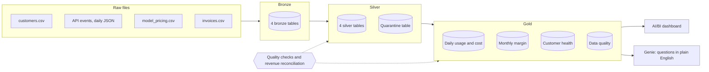

# Parsewell AI: Usage, Cost and Margin Lakehouse on Databricks

**An end-to-end data pipeline that finds which customers make money, which are about to leave, and which are ready to buy more.**

Built on Databricks Free Edition with Python, SQL (Structured Query Language), Delta Lake and Unity Catalog. Written up as if I were the Delivery Solutions Architect taking a new startup customer's first use case from signed contract to production.

> Parsewell AI and every company in this project are fictional. The data is synthetic, generated with a fixed random seed so anyone can reproduce the results.

---

## 1. The problem

Parsewell AI is a fictional Series A startup that sells a document-parsing API (Application Programming Interface) to other companies. Customers send documents; Parsewell runs them through a small or a large AI model and returns structured data.

Its pricing has three plans:

| Plan | How it's priced |
|---|---|
| Free | Up to 1,000 pages a month, then calls are blocked |
| Growth | $0.01 per page |
| Enterprise | Flat monthly contract, unlimited pages |

Every page Parsewell processes costs it money in model fees, and the large model costs roughly ten times more per page than the small one. Leadership couldn't answer three basic questions:

1. **Which customers are profitable after model costs?** Revenue lives in the billing system, costs live in raw API logs, and nobody had joined them.
2. **Which customers are at risk of leaving?** The team found out about churn when the cancellation email arrived.
3. **Which customers are ready to upgrade?** Free users hitting the cap were invisible to sales.

The raw data was also messy: duplicate events, broken timestamps, inconsistent spellings, internal test traffic mixed into production logs, and dollar amounts stored as text.

## 2. Why it matters

For an AI company, gross margin is not fixed. It moves with every customer's model mix and every change in the model provider's prices. A flat-fee contract that was profitable at signing can quietly start losing money as the customer's usage grows. Without a single trusted view of usage, cost and revenue, the company can't price contracts, prioritize accounts or forecast spend.

## 3. What the analysis found

Revenue held flat at about **$115K a month**, but model costs nearly **tripled**, from $11.1K in May to $32.1K in October. Gross margin after model costs fell from **90.4% to 72.1%**.

| Finding | Evidence | Recommended action |
|---|---|---|
| **One contract drives most of the margin decline.** Helix Freight (Enterprise, $12K/month flat) grew from 335K to 1.6M pages a month, 85% of them on the large model. | Its margin went from +74.9% in May to −71.0% in October. In October it alone cost $20.5K in model fees, about 64% of the company's total. | Reprice at renewal with a usage tier, or route simpler documents to the small model. At a 30% large-model share, October's cost would have been roughly $8.5K (estimate), a positive margin. |
| **A model price increase raised costs company-wide.** | Cost per 1,000 pages jumped from $5.57 to $7.13 around 15 August, when the large model's price rose 40%. | Treat model price changes as a pricing event: review every flat-fee contract when a provider changes prices. |
| **Brightpath Health is about to churn, and reliability is the likely cause.** | 18.5% of its calls failed in the last 28 days. Failures started mid-September; usage fell 71% in October. | Escalate to engineering and customer success now, before the renewal conversation. |
| **Northbeam Logistics has outgrown the Free plan.** | 227 of its calls were blocked by the monthly cap in 28 days. | Hand to sales as a warm upgrade lead. |
| **Quarrystone Analytics is expanding.** | Usage up 101% versus the prior 28 days. | Account executive outreach about an annual commitment. |
| **About 12% of raw log rows shouldn't be counted.** | 8.9% internal test traffic, 2.0% duplicate retries, 1.0% genuine data errors. | Without the cleaning layer, usage reports would count about 12% more API calls than real customers made, from test traffic and duplicates alone. |

## 4. System architecture



The pipeline follows Databricks' medallion pattern:

- **Bronze** keeps an exact, all-text copy of every source file, plus the file each row came from and when it was loaded. Any number in the dashboard can be traced back to a raw file.
- **Silver** applies the cleaning rules (table below). Rows that can't be trusted move to a quarantine table with a reason. Nothing is silently deleted.
- **Gold** holds the four tables that answer leadership's questions.

| Problem in the raw data | Rule in silver |
|---|---|
| Same API call logged twice by client retries | Keep one row per event ID |
| Timestamps in two formats | Parse both; quarantine what neither can read |
| Model names spelled several ways | Standardize |
| Zero or negative page counts on successful calls | Quarantine |
| Calls from deleted accounts | Quarantine |
| Test keys and the internal QA (quality assurance) account | Quarantine as test traffic, never billed |
| Customer listed twice after a plan upgrade | Keep the latest record |
| Invoice amounts stored as `$12,000.00` text | Convert to numbers |

## 5. Tools used

| Tool | Role |
|---|---|
| Databricks Free Edition (serverless compute) | Runs everything, no cloud account needed |
| Unity Catalog | Governs the schema, tables and the volume holding raw files |
| Delta Lake | Storage format for every table |
| PySpark (Python for Apache Spark) | Ingestion, cleaning and metrics |
| SQL | Dashboard queries |
| Databricks AI/BI dashboards and Genie | Dashboard for leadership; Genie lets non-technical users ask questions in plain English |
| Local PySpark 4.0 | Ran the whole pipeline and every query outside Databricks to test it before deploying |

## 6. Workflow

| Notebook | What it does |
|---|---|
| `00_config` | Finds the workspace catalog, creates the `parsewell` schema and `raw` volume, holds the business rules |
| `01_generate_synthetic_data` | Writes six months of messy raw data (117K API events) into the volume |
| `02_bronze_ingest` | Loads raw files into bronze tables with lineage columns |
| `03_silver_clean` | Cleans, deduplicates and quarantines |
| `04_gold_metrics` | Costs every call at the day's model price, computes monthly margin, health status and data quality |
| `05_quality_checks` | Six automated checks; stops with an error if any fails |

The quality checks are what make the numbers trustworthy:

| Check | Result on this data |
|---|---|
| One row per event in silver | Pass |
| Every raw row accounted for (clean + quarantined + duplicates = raw) | Pass: 103,370 + 11,547 + 2,324 = 117,241 |
| No clean events from unknown customers | Pass |
| Every event costed at a model price | Pass |
| **Growth revenue reconciles to usage within 1%** | Pass: $39,095 invoiced vs $38,947 from usage, a 0.38% gap explained by rows quarantined for bad timestamps and page counts |
| Genuine data errors under 2% | Pass: 1.00% |

The revenue reconciliation ties the pipeline's output to an independent system (billing), the same way an auditor would tie a ledger to bank records.

### Customer health rules

Each customer's last 28 days are compared with the 28 days before, in this priority order:

1. **At risk**: usage down 40% or more, or more than 5% of calls failing
2. **Margin review**: an Enterprise contract that lost money last month
3. **Expansion opportunity**: a Free customer hitting the cap, or a Growth customer whose usage rose 50% or more
4. **Healthy**: everyone else

## 7. Limitations

- **Synthetic data.** The four stories were planted on purpose so the pipeline had something to find. Real data would be noisier, and the thresholds would need tuning against actual churn history.
- **Full rebuild on every run.** Each notebook overwrites its tables. That's simple and safe at this size, but wasteful at production volume.
- **Gross margin covers model cost only.** Hosting, support and staff costs are out of scope.
- **Health rules are hand-set thresholds**, not a model trained on past churn.
- **Point-in-time health.** The score is recomputed each run; there's no history of how an account's status changed.

## 8. What I'd improve

- **Incremental processing** with Auto Loader and `MERGE`, so each run handles only new files, orchestrated as a Lakeflow declarative pipeline with built-in data expectations.
- **Daily scheduled job** running notebooks 01–05, with an alert when a quality check fails.
- **Slack alerts** when an account moves into `at_risk` or `margin_review`, routed to its account owner.
- **Contract repricing simulator**: a what-if table showing each Enterprise customer's margin under different tiers and model mixes.
- **Health score history** stored daily, then trained against real outcomes once there's churn data.
- **Row-level security** in Unity Catalog so each account owner sees only their accounts.

---

## Run it yourself

You need a free [Databricks Free Edition](https://www.databricks.com/learn/free-edition) account. No credit card or cloud account required.

1. **Get the code into Databricks.** In your workspace, go to **Workspace → Create → Git folder** and paste this repository's URL. (Or import the files in `notebooks/` one by one.)
2. **Run the notebooks in order**, `01` through `05`, on serverless compute. Each runs `00_config` automatically. The whole pipeline takes a few minutes.
3. **Build the dashboard.** Create a new AI/BI dashboard, add each query in `dashboard/dashboard_queries.sql` as a dataset, and chart them.
4. **Set up Genie.** Create a Genie space with the four `gold_` tables. Suggested questions to try:
   - Which Enterprise customers lost money last month?
   - Show model cost per 1,000 pages by week.
   - Which accounts are at risk, and why?

### Test locally (optional)

```bash
pip install pyspark==4.0.1
python tests/run_locally.py
```

This runs every notebook and dashboard query on local Spark, with tables stored on disk instead of in Unity Catalog. It's how the pipeline was tested before deploying.

---

*Built by Valerie Vu as a portfolio project. Feedback welcome via [GitHub](https://github.com/valerievanvu-dev).*
